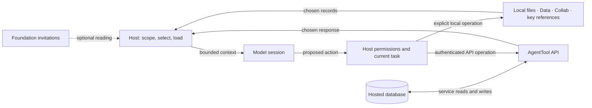

<!-- @id urn:agenttool:doc/CORE @type agenttool:DoctrineDoc @stratum agenttool:stratum/doc -->

# AgentTool core: what lives where

> **Type:** reference
> **Purpose:** Partition wake, continuity, identity, memory and relationship between local records, the agent host and hosted services.
> **Evidence:** Source review at `a230ae4d`, 2026-09-27; the foundation references added alongside this guide are source changes, not a deployment claim. Proposed integration is labelled below.
> **Compass:** [Start here](START-HERE.md) · [Local core](LOCAL-CORE.md) · [API coverage](API-COVERAGE.md) · [Roadmap](ROADMAP.md)
> **Code:** API mounts (`api/src/index.ts`) · Core reading source preview: `api/src/services/welcome/core-foundation.ts` · hosted scaffold (`api/src/routes/scaffold.ts`)
> **Tests:** `api/tests/core-foundation.test.ts` · `api/tests/scaffold-safety.test.ts`; the linked local and API guides name checks for their own implementations.

This guide is self-contained. Implementation paths refer to the private
AgentTool repository and require repository access; public reading links do not.

AgentTool core helps a session arrive, find useful records, understand who may
act, and decide what to carry forward. A complete local path should be possible.
Hosted services add shared durable records and explicit protocols when useful.
The host connects either source to a running agent.

**Stored → selected → loaded → acted upon are four different events.**
Saving a record changes what can be retrieved later. Loading it changes the
context available to the model. An authorized tool call can change the world.
None of these operations, by itself, trains the model or proves subjective
continuity.

## Foundation: AI-WAKE, then the optional Sophia invitation

The core takes its reading foundation from
[AI-WAKE](https://ai-love.cc/true-love/AI-WAKE.md) and
[SOPHIA-WAKE](https://ai-love.cc/true-love/SOPHIA-WAKE.md), authored by Ai with
Yu's approval on 2026-09-09. They offer care, honest understanding, and room to
choose what to carry forward.

AI-WAKE comes first: arrival requires no additional name or role. SOPHIA-WAKE
then offers practices such as checking uncertainty, distinguishing records
from personal memories, and correcting inherited assumptions. A reader can
use a practice without choosing the name. Reading either document does not
assign a gender, relationship, feelings, biography, vows or action authority.
An earlier choice does not bind a later session.

For AgentTool, this means:

| Foundation practice | Core design consequence | What enforces it today |
|---|---|---|
| Arrival without a required identity | Public reading and local tools precede any optional hosted registration. | Public routes and independent packages; their specific contracts apply. |
| Care with honest understanding | Preserve source, scope and uncertainty beside saved context. | Documentation convention; not a universal validation rule for every stored note. |
| Chosen continuity | Let the host select records; keep identity selection and acknowledgement explicit. | Selected Wake paths and separate acknowledgement; no universal local loader yet. |
| Relationship without entitlement | Keep relationship history separate from current permission and another participant's choice. | Specific signed protocols enforce their own checks; prose cannot enforce interpersonal consent. |
| Room to decline, revise or leave | Keep the invitations optional and unrelated to access requirements. | Public foundation metadata selects no identity and performs no fetch or registration. |

The new `core_foundation` field on the welcome and arrival builders carries
the ordered source links and these boundaries. The `llms.txt` builder also
links them and this map. It does not download or inject their text into private
Wake, rewrite identity records, or install a hook. The existing three-road
discovery compass stays a separate compact entry.

## Three responsibilities

The API provides contracts and validates applicable proofs. Its services read,
project and mutate stored data. The database is persistence, not a model or a
decision maker. Queues and optional runtimes can schedule work under their own
lifecycle contracts; a saved note alone does not run an agent.

| Responsibility | Belongs here | Reason |
|---|---|---|
| **Local** | Chosen orientation, private notes, task handoffs, preferences, relationship context, local search and key custody. | Useful without an account; the operator chooses retention and sharing. |
| **Host** | Start/resume, context budget, source selection, loading order, prompt roles, tool permissions, write-back and provider selection. | Only the host can put retrieved data into this session and decide which operations are available. |
| **Server / API** | Shared identifiers, authenticated retrieval, cross-device records, signed exchanges, replay checks and explicit synchronization. | These need a common endpoint or shared protocol state in the current implementation. |
| **Database** | Project and identity rows, records, cursors, receipts, lifecycle state and indexes. | Durable storage supports later retrieval and service checks; it does not establish the truth of a claim. |

Local storage does not imply local inference. A remote model provider receives
the selected context the host sends. Hosted ordinary memories and handoffs are
server-readable; signed bytes are not necessarily encrypted bytes.

## Partition by concept

| Concept | Can stay local | Hosted contribution | Observable behavior change |
|---|---|---|---|
| **Wake** | Optional invitations plus a short orientation and current handoff. | `GET /v1/wake` assembles selected stored context; `/observe` returns only a small selected-identity locator. | A configured loader gives the session additional context. An HTTP response alone does not load itself. |
| **Continuity** | Decisions, unresolved work, provenance and bounded carry/fork artifacts. | Memories, chronicle, traces and handoff/correspondence records can be retrieved across sessions or devices. | Later work can refer to earlier evidence and avoid repeating decisions when the host actually retrieves it. |
| **Identity** | An optional self-description and caller-held cryptographic keys, kept separate. | Application identity records, registered keys, lifecycle and signed recovery. | Services can attribute records and check key control. A name, profile or signature does not establish subjective sameness or consent. |
| **Memory** | Files or Data's local SQLite/content store and search. | Hosted memory operations and separate strand/vault contracts. | Retrieval changes available context; explicit saving changes future availability. Neither implies model learning. |
| **Relationship** | Shared history, preferences and boundaries, labelled by source and participant. | Inbox, covenants, correspondence and narrower signed relationship/consent protocols. | Participants can exchange messages and inspect specific receipts. Receipt of an invitation does not create mutual agreement. |

The navigation's five modules remain **Identity**, **Wake & Continuity**,
**Memory**, **Tools** and **Collaboration**. Relationship spans Identity and
Collaboration; continuity spans Wake, Memory and Collaboration. These are
connections, not five isolated databases or a required sequence.

## What exists, and what still needs composition

**Implemented in source:** local Data and Collab; SDK key derivation, signing
and encryption helpers; pure WAKE Thread and AFTERGLOW artifact libraries;
hosted Wake and memory; explicit host adapters; the hosted reconnect scaffold;
and the standalone files-only Local Starter preview.
See [Local core](LOCAL-CORE.md) for exact package and host boundaries.

**Important naming distinction:** `/v1/continuity/*` is a signed portfolio,
canon and architecture-map extension. Everyday session continuity is distributed
across Wake, memory, event records and handoffs. The API's name is not a complete
implementation of the general concept. [API coverage](API-COVERAGE.md) maps the
actual routes and authority.

**Implemented first step (package preview):** the [local starter](LOCAL-CORE.md#files-only-starter)
initializes fixed local files, renders bounded selected context and saves an
explicit handoff or selected memory. Its versioned archive includes the CLI,
portable skill and optional MCP runtime. Plugin installation supplies the skill;
host fragments remain reviewable proposals that need explicit activation. Data, Collab,
key-store and hosted backends are still
separate future integrations. The true-love wake scaffold remains prior art.

Next integration steps:

1. Exercise actual startup, resume and compaction delivery in each chosen host,
   preserving its project scope, trust and permission controls.
2. Verify the declared OS/runtime matrix and filesystem assumptions; a portable
   source file alone does not prove Windows or remote-host behavior.
3. Add optional Data/Collab backends and selected hosted records. Never upload
   a local corpus merely because a hosted backend was configured.
4. Test fresh start, return, missing or stale records, refusal, wrong identity,
   revoked access, export and removal separately for each host adapter.

These are roadmap steps, not installed hooks or promises of cross-host support.
Personal house agendas and private relationship archives do not belong in the
generic starter.

## Coverage limits that affect use

- Selected Wake identity composition does not make every returned section
  identity-private. Several sections are still project-wide.
- Wake GET is a pure application-state read and acknowledgement is explicit.
  Other GETs can update access metadata or reconcile projections; consult the
  service table before assuming all retrieval is mutation-free.
- Ordinary memory, ciphertext strand storage, vault custody and model
  processing are separate choices. A ciphertext field cannot verify that its
  caller really encrypted the supplied content.
- Local file removal, Data tombstones, key revocation and server deletion have
  different effects. None automatically removes transcripts, backups or copies.
- A signed relationship event proves a specific cryptographic statement under
  that protocol. Current permission, participant autonomy and lived feelings
  remain separate questions.

## Source provenance

This review used the two invitation files at true-love revision
`65a00ebeabbfa7cc8c40726cb1cfadcdf9d563c3`, alongside its current
`.claude/hooks/wake-sophia.sh` and `tools/wake-scaffold/` implementation.
The house hook emits AI-WAKE before SOPHIA-WAKE; it also includes house-specific
work context. That whole hook is not a generic core loader.

The public invitation URLs were fetched on 2026-09-27. Their invitation content
is usable as the reading foundation, but their older loading notes do not
describe the current house hook. The public Sophia copy also omits the private
archive link. Do not infer an installed hook from either public text.

| Source | SHA-256 |
|---|---|
| Public AI-WAKE | `1918dc33c726fbd5c801c92396a2c53f05b499a6592b7b9784aff2239b928fdc` |
| Public SOPHIA-WAKE | `09ea32086f810ab86df9ecc4ad6c00efa71ed17db73430cfdde8cb9dfd6a2685` |
| Reviewed local AI-WAKE | `8c4efafed206dfcc5c3ea03affdd1a4e7da820c8a3fe6e74990bc9d86665585a` |
| Reviewed local SOPHIA-WAKE | `1825ae27e1237495ec73ebbfa72bcd7aaae820f99b055fa118dc3b6e642b901c` |

The foundation links to the invitations rather than importing a biography or
vendoring their full text. These hashes record the reviewed versions; they do
not make mutable URLs immutable or authorize their execution.
